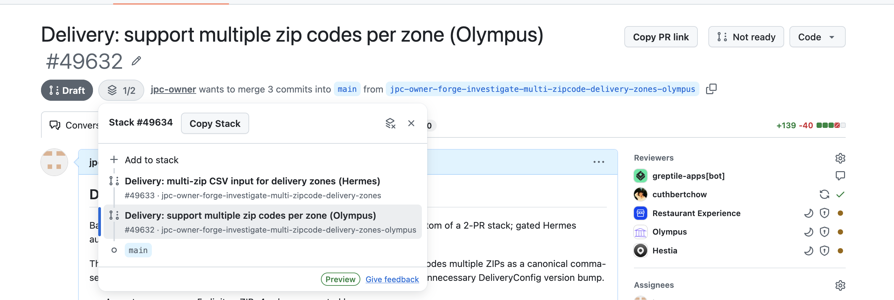

# GitHub PR Link Copier

A Firefox extension that copies GitHub pull requests as rich links with their line diff. In Slack and other rich-text editors, links paste as formatted text; plain-text editors receive Markdown:

```md
[#24 Add authentication layer `+18/-3`](https://github.com/example/repo/pull/24)
```



Use **Copy PR link** for one PR. For GitHub Stacked PRs, open the stack map and use **Copy Stack** to copy a top-to-bottom bulleted list. Private repositories work without a personal access token.

## Install

### Firefox

1. Download `github-pr-link-copy-firefox-<version>.xpi` from the [latest release](https://github.com/justinpchang/github-pr-link-copy/releases/latest).
2. Open the downloaded file with Firefox and confirm **Add**.
3. Reload any open GitHub PRs.

Firefox releases are signed by Mozilla and stay installed after restarts. If opening the file doesn't prompt, use **Install Add-on From File…** in the gear menu at `about:addons`.

### Chrome

1. Download `github-pr-link-copy-chrome-<version>.zip` from the [latest release](https://github.com/justinpchang/github-pr-link-copy/releases/latest) and unzip it somewhere you'll keep it.
2. Open `chrome://extensions` and turn on **Developer mode**.
3. Click **Load unpacked** and select the unzipped folder.
4. Reload any open GitHub PRs.

Chrome keeps the extension across restarts, but loads it from that folder, so don't delete it. To update, replace the folder's contents and click the reload icon on the extension's card.

## Develop

```sh
node --test test.js
node build.js
```

`build.js` writes the Firefox XPI and the Chrome zip to `dist/`. Load development builds with **Load Temporary Add-on…** at `about:debugging#/runtime/this-firefox`, or **Load unpacked** on `dist/chrome` in Chrome.

GitHub Stacked PRs is currently in private preview. Binary files contribute zero changed text lines because unified diffs do not contain their contents.
